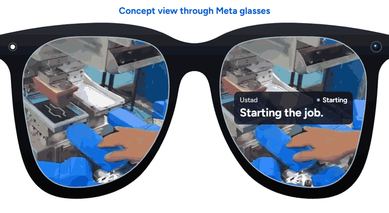
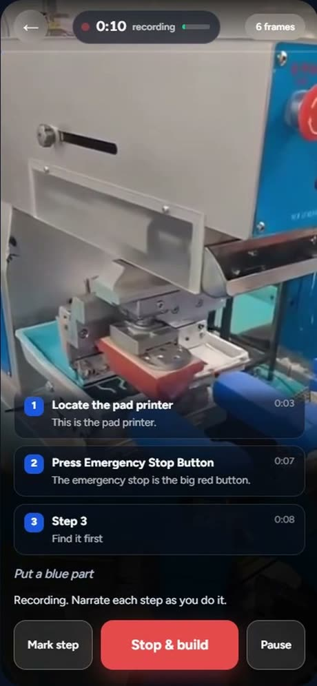
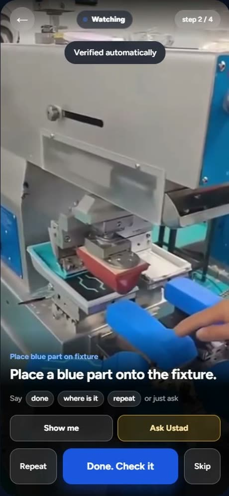
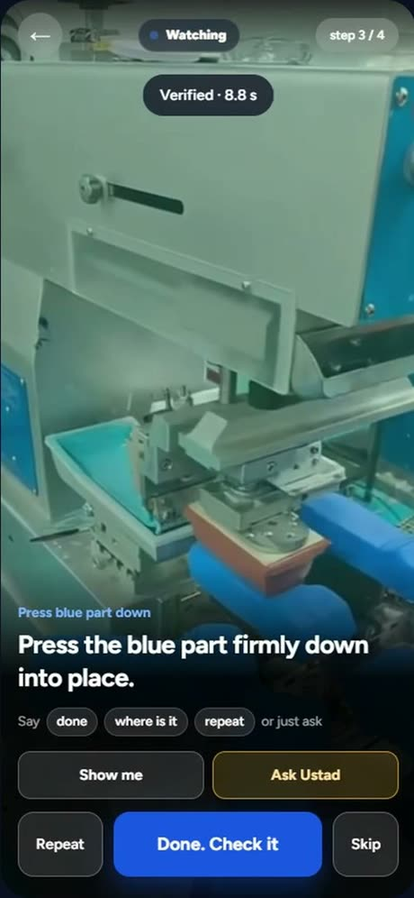
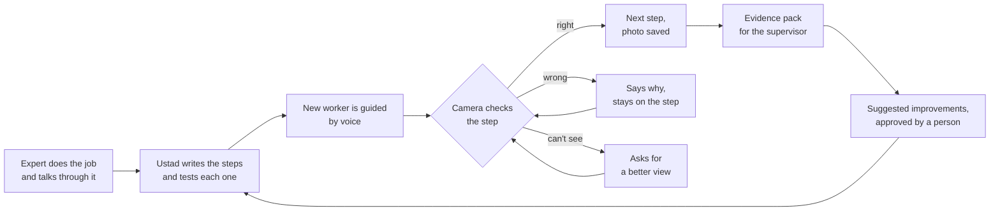
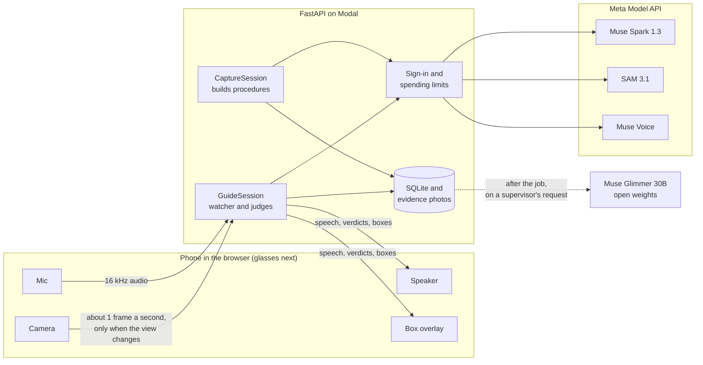
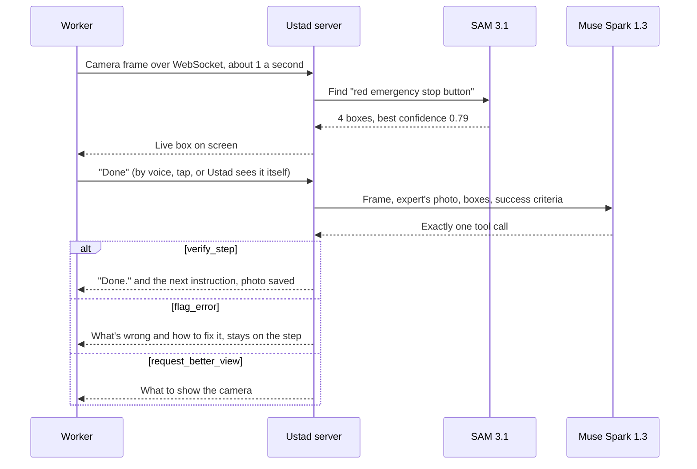

<p align="center">
  
</p>

<h1 align="center">Ustad</h1>

<p align="center">
  <b>An AI co-pilot for factory workers.</b><br />
  An expert shows a job once. Ustad guides every new worker through it, and checks each step on camera.
</p>

<p align="center">
  <a href="https://prabindersinghh--ustad-web.us-east.modal.run"><b>Live demo</b></a> &nbsp;·&nbsp;
  <a href="#how-it-works">How it works</a> &nbsp;·&nbsp;
  <a href="#under-the-hood">Under the hood</a> &nbsp;·&nbsp;
  <a href="#measured-results">Measured results</a> &nbsp;·&nbsp;
  <a href="#run-it-yourself">Run it</a>
</p>

<p align="center">
  
  <br />
  <sub>Concept view over real factory footage: how Ustad could look through glasses with a display. Not tested on glasses yet. Today it runs on a phone.</sub>
</p>

Built for the Meta Global AI Developer Hackathon 2026: Indie Developer track, *Push the Frontier*.

> **Trying the live demo?** The landing page is open. The app needs the demo access code, which is in the hackathon submission.

---

## The problem, in plain words

Picture a machine that prints on plastic parts. A wrong move can hurt a hand or ruin the part.

An experienced worker knows every step by heart. A new worker doesn't. The expert can't stand beside them all day, and when that expert leaves, the knowledge leaves too. Paper instructions take long to write, go out of date, and can't see whether the work was done right.

So new workers learn by trial and error, and mistakes show up as scrap, downtime or injuries.

## What Ustad does

| | |
|---|---|
| **1. The expert shows the job once** | They do the work and talk through it, wearing a camera. Ustad writes the steps by itself, in seconds. |
| **2. Ustad guides the new worker by voice** | One step at a time, hands free. In English or Hindi. The worker can ask questions out loud. |
| **3. The camera checks each step** | Ustad looks at the work itself. If it's right, it moves on. If it's wrong, it says why. If it can't see, it asks for a better view. |
| **4. Every job leaves a record** | Each check saves its photo, verdict and reason in an evidence pack nobody had to write. |

<table>
  <tr>
    <td align="center"><br /><sub>The expert records. Steps appear as they talk.</sub></td>
    <td align="center"><br /><sub>The worker is guided, one step at a time.</sub></td>
    <td align="center"><br /><sub>The step is verified before moving on.</sub></td>
  </tr>
</table>

<sub>Real app screens. The factory clip was fed in as the camera.</sub>

### Why this isn't a chatbot looking at a photo

The camera's answer **changes what happens next**. The AI can't just give an opinion: it has to pick exactly one action, and the server carries it out. In our test run, a worker marked a step done while the bottle was still on the table. Ustad refused twice, said why, and passed only when the bottle was really in the air.

## Built for Meta glasses

Meta glasses are where Ustad is going: a camera that sees what the hands do, microphones that hear the worker, and speakers that talk them through it, with both hands on the job.

**Today it runs in the browser on a phone clipped to the chest.** A phone gives the same three things, so the client is a thin media layer that glasses would slot into, with the same backend and the same job cards. **It has not been tested on glasses yet.** Glasses with no display would speak the same words the concept view above shows on screen.

## Where we've tried it

We tested Ustad in two factories: a textile clothing factory, and MCPL (Modern Colours Private Limited) in Ludhiana. We are starting with India, a huge market. Trial figures are still in progress, so the numbers below come from our own test runs.

---

## How it works



## Under the hood

### The Meta models, and what each one does

| Model | Job | Why it matters |
|---|---|---|
| **Muse Spark 1.3** | Writes procedures, makes every step decision through tool calls, answers workers' questions | The decision is an action the server executes, not a paragraph |
| **SAM 3.1** | Finds the part named by a phrase, with boxes and a confidence | Gives the decision a fact to work from, not only an impression |
| **Muse Voice** (`muse-voice-transcribe-1.0`) | Live speech to text, including Hindi | Hands-free commands and narration |
| **Muse Glimmer 30B** (open weights) | A second opinion after a job | An independent audit, and the route toward on-site deployment |

### System



### One check, start to finish



The numbers above come from a real check: `verify_step`, confidence 0.95, 3.4 s.

<details>
<summary><b>Capture: from a recording to a checkable procedure</b></summary>

<br />

1. The phone streams 16 kHz audio to realtime speech to text, and a frame every 2 s when the view changes. Draft step cards appear as the expert talks.
2. On stop, up to 12 keyframes and the narration go to Muse Spark, which returns structured steps:

   ```json
   { "title": "Locate emergency stop button",
     "target_phrase": "red emergency stop button",
     "success_criteria": "Big red mushroom button visible on blue control panel at upper right.",
     "hazard": "Locate the emergency stop before operating the machine.",
     "check": "visual",
     "watch_for": [{ "phrase": "moving print head", "role": "hazard" }],
     "expert_said": "...", "ref_image": "...", "ref_box": { "confidence": 0.76 } }
   ```

3. **It checks its own work.** SAM 3.1 tests every phrase on the expert's own frame. For a miss, Muse Spark suggests 3 alternatives, all tested in parallel, and the first hit wins.
4. Long takes are written in parts while recording, so stopping a long recording doesn't mean a long wait.
5. If the Wi-Fi drops, the phone keeps recording, and sends frames, marks and audio when it reconnects.

</details>

<details>
<summary><b>Guide: why it feels instant</b></summary>

<br />

- **The watcher** grounds the newest frame about once a second, with up to 2 SAM calls in flight. A generation counter drops stale results after a step change.
- **Background judges** run on grounded frames, up to 3 in flight, so an ordinary step can verify itself without the worker saying anything. One pass at 0.9 or above advances it.
- **Stricter steps need more.** Lockout, reading, timed and confirm steps need two passes, and a timed step can't finish early.
- **Safety gate.** A single check can credit steps the worker already did ahead of time, but only ordinary visual steps with no hazard. The jump stops at the first step that isn't.
- **Hazards.** SAM also tracks hands and each hazard. A hand too close triggers a spoken warning while the job continues.
- **Readings** such as a pressure value out of range are overridden to `flag_error` in server code, not left to the model.
- **Reasoning effort** is kept minimal on checks: the main lever on latency, with output tokens capped so one check can't run away.

</details>

<details>
<summary><b>Ask Ustad: questions on the job</b></summary>

<br />

The worker just asks: "which one?", "it won't turn", "can I skip this?". Muse Spark answers from the expert's recorded words and the live view, and must use a tool:

- `answer` can point: SAM lights up the part in the worker's view.
- `check_now` runs the step check.
- `escalate` stops the worker and logs it for a supervisor. That's what happens to "can I skip the lockout?".

After two failed checks, Ustad offers help without being asked.

</details>

<details>
<summary><b>Hindi: only the words change</b></summary>

<br />

Each procedure version is translated once and cached. SAM phrases and success criteria stay as captured, so the check is identical. Numbers are verified in code: a translated field with changed numbers is thrown away, and a lost warning falls back to the original.

</details>

<details>
<summary><b>Procedures that improve</b></summary>

<br />

Muse Spark reads where workers failed, asked and skipped, then proposes concrete edits. Every new phrase is tested by SAM on the expert's photo. A supervisor approves each change, and each approval creates a new version, so past jobs still point to the steps they really ran.

</details>

<details>
<summary><b>Second opinion on open weights</b></summary>

<br />

After a job, a supervisor can send it, or only its doubtful steps, to Muse Glimmer: a failed or unclear check, more than one attempt, or confidence under 0.8 (a starting value, not a tuned one). It uses the same judge code.

- It never changes the job's record, and it runs in the background.
- A failed call stays a failure. It's never answered by another model, because the record names the model that judged.
- Only the photos shown on the page are sent, after a warning, because they leave for NVIDIA's API.

Running Glimmer on a GPU inside a plant is the design for keeping footage on site. **That part isn't tested yet.**

</details>

<details>
<summary><b>Learning from real work: the reinforcement learning pipeline</b></summary>

<br />

Every checked step is a labelled example: what was asked, what the camera saw, what SAM found, and what the right call was. `scripts/make_episodes.py` turns footage into training data in the exact prompt format production uses.

From one 42-second factory clip it built **1,046 labelled examples**: 710 for training, and 336 held out (228 normal, 108 deliberately degraded), with no frame in both sets.

Labels come from what each frame shows. A blind "different step means error" rule would have mislabelled 588 frame and step pairs, because the machine is in view all the time. Those labels were made by an AI viewing the frames, not by a factory expert.

**Nothing has been trained yet, so there's no accuracy figure.** This is the groundwork for a verifier that improves with use.

</details>

### Decisions worth defending

| Decision | Why |
|---|---|
| **Tool calls, not free-text verdicts** | A constrained call is auditable and executable. It makes this a real agentic loop. |
| **Boxes and confidence, not decoded masks** | Masks cost a decoder and add nothing to verification. |
| **Browser app, not a native app** | No app store and nothing to install. The phone exposes what glasses do: camera, mic and speaker. |
| **Live guiding on the fast model** | Glimmer took 63 s a check against 4.6 s. A worker can't wait a minute, while an audit can. |
| **Safety steps are never inferred** | Lockout and hazard steps are never credited from a later view. |
| **No silent fallback on the record** | Every event names the model that judged it. |

### Security and limits on the public link

| Control | What it does |
|---|---|
| **Demo sign-in** | App, data, photos and sockets need a code. Signed, HttpOnly, Secure cookie. Attempts are rate limited. The landing page stays open. |
| **Supervisor token** | Separate, for approving changes and sending photos out for a second opinion. |
| **Spending limits** | Checked before every paid call: a total budget and an hourly cap. |
| **Session limits** | Per device, at once and in length, so one phone left running can't drain credits. |
| **Data handling** | Keys in environment secrets only. Worker's words are quoted to the model as data, not instructions. |

The demo's sign-in is one shared code. A plant would sign in with its own accounts, per person.

---

## Measured results

From our own test runs against the live Meta APIs, November 2026.

| | |
|---|---|
| From "done" to a decision | 4 to 5 s |
| From saying "done" to the check starting | 0.3 s |
| Finished step to the next instruction | about 7 s |
| Short recording to a checked job card | 17 to 34 s |
| Cost to record one job | about $0.08 |
| Cost of guiding a 4-step job | about $0.10 |

| 8 test cases, 4 deliberately wrong | Right | False passes | Median per check |
|---|---|---|---|
| Muse Spark 1.3 (live) | 8 of 8 | 0 | 4.6 s |
| Muse Glimmer 30B, base model, through NVIDIA's API | 8 of 8 | 0 | 63 s |

That's a small sample. `scripts/evaluate.py` replays labelled frames through the same `judge_step` code the live loop runs, and reports false passes as the safety-critical number. 283 automated tests run with no network.

### What isn't done yet

We'd rather say this than have you find it.

- **Trial figures** from the factories are still in progress.
- **Glasses:** not tested on any glasses. The view at the top is a concept.
- **Reinforcement learning:** data pipeline built, nothing trained.
- **On-site Glimmer:** only run through a hosted API so far.
- **SAM on small objects:** on a 480 px factory clip it found 9 of 25 object and frame pairs. Ustad then judges from the image alone, and the record shows no box. 2x upscaling didn't help; better phrases do.
- **Hindi:** real accents and factory noise haven't been tested.
- **Accounts:** one shared demo code, not per-person sign-in.

---

## Run it yourself

```bash
pip install -r requirements.txt
cp .env.example .env            # add your Meta Model API key as MODEL_API_KEY
python -m scripts.smoke_test    # checks each model works
uvicorn backend.main:app --host 0.0.0.0 --port 8000
```

```bash
python -m pytest tests/ -q      # no API key needed
```

Phones need HTTPS for the camera, so use a tunnel for testing: `cloudflared tunnel --url http://localhost:8000`. With no `DEMO_ACCESS_CODE` set, local work has no sign-in.

**To try Muse Glimmer**, add a key from build.nvidia.com:

```
OPEN_BASE_URL=https://integrate.api.nvidia.com/v1
OPEN_MODEL=meta/muse-glimmer-30b
OPEN_API_KEY=...
```

<details>
<summary><b>Repo layout</b></summary>

<br />

```
backend/
  access.py          demo sign-in and spending limits
  config.py          settings
  meta_client.py     Meta Model API: reason, segment, transcribe
  sam_parse.py       SAM 3.1 token grammar to typed boxes
  realtime.py        realtime speech relay, voice intents
  procedures.py      capture: narration and keyframes to procedure
  guide.py           perception, decision, Ask Ustad, tool definitions
  live.py            live sessions: watcher, judges, capture, resume
  translate.py       procedure translation, numbers checked in code
  improve.py         suggested edits, approved by a person
  second_opinion.py  Muse Glimmer audit after a job
  db.py              SQLite: procedures, sessions, events, usage
  main.py            FastAPI app, sockets, REST
web/                 landing, app, dashboard, evidence pack
scripts/             smoke test, evaluation, replay, RL episodes, overlay renderer
deploy/              the public link on Modal
tests/               283 tests, no network
docs/                architecture, decisions, runbook, status, timeline
```

</details>

Developers and coding agents: start with [AGENTS.md](AGENTS.md). Full detail is in [docs/ARCHITECTURE.md](docs/ARCHITECTURE.md) and [docs/DECISIONS.md](docs/DECISIONS.md).

## Licence

Copyright (c) 2026 Prabinder Singh. All rights reserved.

This source is public so the hackathon's judges and organisers can review it, as the event's rules allow. It isn't open source, and no licence to reuse it is granted beyond the rights given to the organisers in the hackathon's Official Rules. Open-source libraries it uses keep their own licences.
